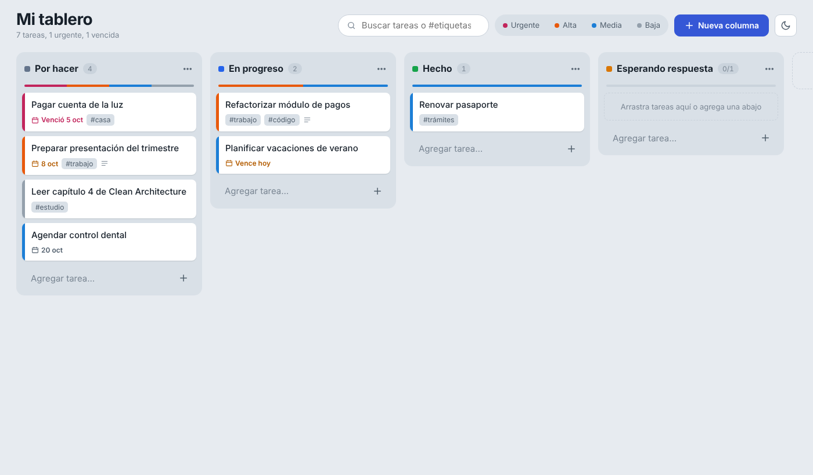

# Kanban Hexagonal

Tablero kanban personal para organizar y priorizar tareas. Corre 100 % en tu
máquina, guarda todo en un archivo JSON y está escrito en **TypeScript** con
**arquitectura hexagonal**, principios **SOLID** y **tests unitarios con test doubles**.



## Funcionalidades

- Columnas que puedes **crear, renombrar, recolorear, reordenar (arrastrando) y eliminar**.
  Al eliminar una columna con tareas eliges si moverlas a otra o borrarlas.
- **Límite de tareas en curso (WIP)** opcional por columna: la columna se marca al superarlo.
- Tareas con título, descripción, **prioridad** (baja, media, alta, urgente), fecha límite y etiquetas.
- **Arrastrar y soltar** tareas entre columnas o dentro de la misma.
- **Ordenar una columna** por prioridad o por fecha límite.
- Medidor de prioridades en cada columna, fechas vencidas o próximas resaltadas.
- Búsqueda por texto o `#etiqueta` y filtro por prioridad.
- Tema claro y oscuro. Atajos: `/` para buscar, `n` para agregar una tarea.

## Requisitos y ejecución

Solo necesitas **Node.js 22.18 o superior** (ejecuta TypeScript de forma nativa).
**No hay dependencias en tiempo de ejecución**: no hace falta `npm install` para usarlo.

```bash
npm start            # abre http://localhost:3000
npm run dev          # igual, pero se reinicia al cambiar el código
npm test             # tests unitarios
npm run test:coverage
```

Opcional, para verificar tipos con el compilador:

```bash
npm install          # instala typescript y @types/node (solo desarrollo)
npm run typecheck
```

Variables de entorno opcionales:

| Variable    | Por defecto        | Uso                                  |
|-------------|--------------------|--------------------------------------|
| `PORT`      | `3000`             | Puerto HTTP                          |
| `HOST`      | `127.0.0.1`        | Solo accesible desde tu equipo       |
| `DATA_FILE` | `./data/board.json`| Dónde se guarda el tablero           |

Para respaldar tus tareas, copia `data/board.json`.

## Arquitectura hexagonal

```
                 ┌──────────────────────────────────────────────┐
  Navegador ───► │ Adaptador de entrada: HTTP (BoardController) │
  (public/)      └───────────────────────┬──────────────────────┘
                                         │ usa puertos de entrada
                                         ▼
               ┌────────────────────────────────────────────────────┐
               │ APLICACIÓN  casos de uso: CreateTask, MoveTask...  │
               │   ┌────────────────────────────────────────────┐   │
               │   │ DOMINIO  Board · Column · Task · Priority  │   │
               │   │          TaskOrdering (estrategias)        │   │
               │   └────────────────────────────────────────────┘   │
               └───────────────────────┬────────────────────────────┘
                                       │ define puertos de salida
                                       ▼
          BoardRepository        IdGenerator          Clock
                 ▲                    ▲                  ▲
   JsonFileBoardRepository   CryptoIdGenerator     SystemClock     ← adaptadores de salida
```

Las dependencias **siempre apuntan hacia el centro**: el dominio no importa
nada de la aplicación ni de los adaptadores, y la aplicación solo conoce
interfaces (puertos). El único archivo que conoce todas las piezas concretas
es `src/main.ts` (composition root).

```
src/
├── domain/                  Reglas de negocio puras (sin Node, sin HTTP, sin disco)
│   ├── model/               Board (raíz de agregado), Column, Task, Priority
│   ├── services/            TaskOrdering: estrategias de ordenamiento
│   └── errors.ts            ValidationError, NotFoundError
├── application/
│   ├── ports/in/            Interfaces de los casos de uso + comandos
│   ├── ports/out/           BoardRepository, IdGenerator, Clock
│   ├── usecases/            Una clase por caso de uso
│   └── decorators/          SerializedUseCase (evita escrituras concurrentes)
├── adapters/
│   ├── in/http/             Router, BoardController, HttpServer, StaticFiles
│   └── out/                 JsonFileBoardRepository, CryptoIdGenerator, SystemClock
└── main.ts                  Composition root
public/                      Interfaz web (HTML, CSS, JS sin compilación)
test/                        Tests por capa + test doubles
```

### Recorrido de una petición

`PUT /api/tasks/42/move` → `BoardController` arma un `MoveTaskCommand` →
`MoveTask.execute()` carga el tablero vía `BoardRepository` → `board.moveTask()`
aplica la regla de dominio → se guarda → se devuelve la vista del tablero → la
interfaz se vuelve a pintar.

## SOLID en el código

| Principio | Dónde se ve |
|-----------|-------------|
| **S**ingle responsibility | Cada caso de uso es una clase con un único `execute`. `Router` enruta, `BoardController` traduce, `HttpServer` maneja el protocolo, `StaticFiles` sirve archivos. |
| **O**pen/closed | Nuevo criterio de orden = nueva clase que implementa `TaskOrdering`; `SortColumn` no cambia. `SerializedUseCase` agrega comportamiento sin tocar los casos de uso. |
| **L**iskov substitution | Cualquier `BoardRepository` (JSON, memoria, Redis) o el decorador `SerializedUseCase` sustituyen al original sin que el resto lo note; los tests lo aprovechan. |
| **I**nterface segregation | Puertos pequeños: `Clock` solo tiene `now()`, `IdGenerator` solo `next()`. Cada caso de uso recibe solo los puertos que usa (`DeleteTask` no recibe `IdGenerator`). |
| **D**ependency inversion | Los casos de uso dependen de interfaces y reciben las implementaciones por constructor; `main.ts` decide cuáles. |

## Tests y test doubles

81 tests con el runner nativo `node:test` (cobertura ≈ 98 %), organizados por capa:

- `test/domain`: reglas del dominio, sin dobles (es código puro).
- `test/application`: casos de uso aislados con dobles.
- `test/adapters`: el controlador con casos de uso simulados, el servidor HTTP y
  el repositorio JSON contra un directorio temporal.

Los dobles están en `test/doubles/`:

| Tipo  | Ejemplo | Para qué |
|-------|---------|----------|
| Dummy | `dummyRepository`, `dummyIds` | Rellenan parámetros y fallan si se usan: prueban que un camino no toca el repositorio o no genera ids. |
| Stub  | `FixedClock`, `SequentialIdGenerator`, repositorio que falla al guardar | Respuestas predecibles para tests deterministas. |
| Spy   | `SpyBoardRepository`, `logger` en `HttpServer.test.ts` | Registran llamadas: “se guardó exactamente una vez”, “no se guardó nada al fallar”. |
| Fake  | `InMemoryBoardRepository` | Persistencia funcional en memoria, rápida y sin disco. |
| Mock  | `mock.fn()` de `node:test` en `BoardController.test.ts` y `SortColumn` | Verifican con qué argumentos se llamó a un colaborador. |

`BoardFixture.ts` incluye un *Test Data Builder* (`aBoard().withColumn(...)`)
para que cada test declare solo los datos que le importan.

## API REST

| Método | Ruta | Cuerpo |
|--------|------|--------|
| GET    | `/api/board` | |
| POST   | `/api/columns` | `{ name, color?, wipLimit?, position? }` |
| PATCH  | `/api/columns/:id` | `{ name?, color?, wipLimit? }` |
| DELETE | `/api/columns/:id?moveTasksTo=<id>` | |
| PUT    | `/api/columns/:id/position` | `{ position }` |
| POST   | `/api/columns/:id/sort` | `{ by: "priority" \| "dueDate" }` |
| POST   | `/api/columns/:id/tasks` | `{ title, description?, priority?, dueDate?, tags?, position? }` |
| PATCH  | `/api/tasks/:id` | campos a cambiar |
| PUT    | `/api/tasks/:id/move` | `{ columnId, position? }` |
| DELETE | `/api/tasks/:id` | |

Todas devuelven el tablero completo actualizado. Errores: `400` validación, `404` no encontrado.

## Cambiar a Redis

Gracias al puerto `BoardRepository`, pasar a Redis es crear un adaptador nuevo
y cambiar una línea en `main.ts`. Por ejemplo, con el paquete `redis`
(`npm install redis`) y Redis con persistencia AOF activada (`appendonly yes`):

```ts
// src/adapters/out/persistence/RedisBoardRepository.ts
import type { RedisClientType } from 'redis';
import type { BoardRepository } from '../../../application/ports/out/BoardRepository.ts';
import { Board } from '../../../domain/model/Board.ts';

export class RedisBoardRepository implements BoardRepository {
  private readonly client: RedisClientType;
  private readonly key: string;

  constructor(client: RedisClientType, key = 'kanban:board') {
    this.client = client;
    this.key = key;
  }

  async load(): Promise<Board | null> {
    const json = await this.client.get(this.key);
    return json ? Board.fromSnapshot(JSON.parse(json)) : null;
  }

  async save(board: Board): Promise<void> {
    await this.client.set(this.key, JSON.stringify(board.toSnapshot()));
  }
}
```

```ts
// src/main.ts
const client = createClient({ url: process.env.REDIS_URL });
await client.connect();
const repository = new RedisBoardRepository(client);
```

Los tests de casos de uso no cambian: siguen usando el repositorio en memoria.
